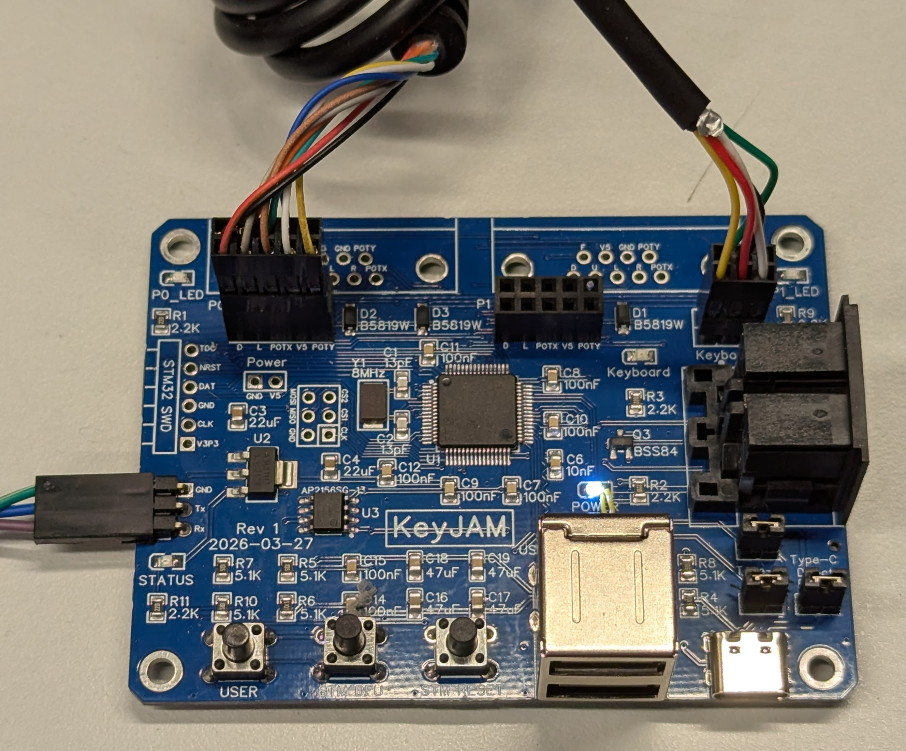
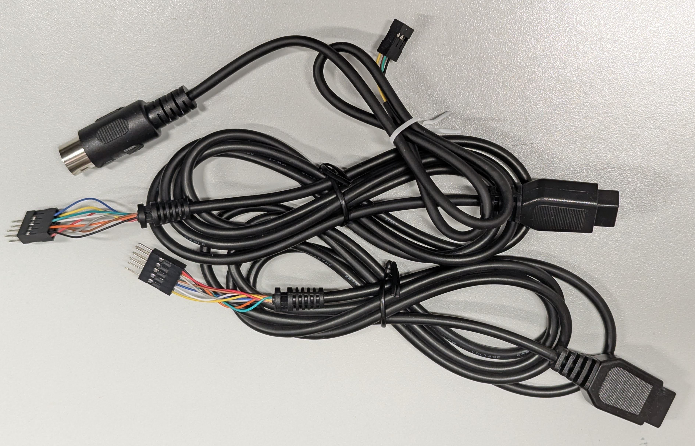
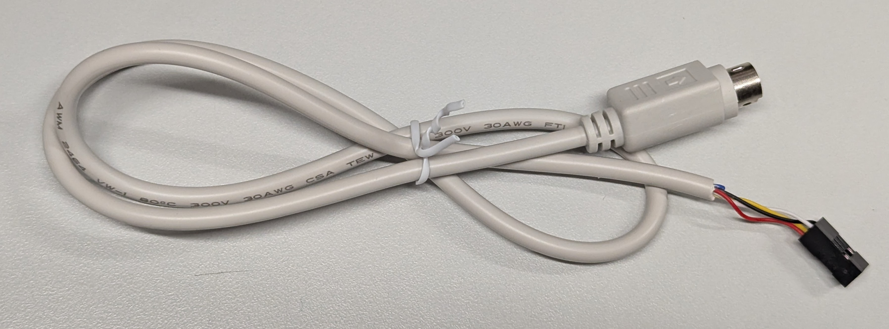

# KeyJAM

**KeyJAM** is an open-source dual USB port to Amiga keyboard and mouse
adapter. Plug a USB keyboard and a USB mouse (or gamepad) into KeyJAM, and
it presents them to the Amiga as a native Amiga keyboard and a native
Amiga mouse or joystick.

Mouse scroll wheels work without any special driver on the Amiga side,
because KeyJAM sends scroll wheel movement to the Amiga as keystrokes.

Features:

- **Two USB Type-A host ports** (stacked) for a USB keyboard, mouse, gamepad, or USB hub.
- **Amiga keyboard output** through a supplied keyboard cable, with cables available for 5-pin DIN (A2000, A3000) and 6-pin mini-DIN (A4000) keyboard connectors.
- **Amiga mouse / joystick output** through supplied DB9 cables, including the POTX and POTY lines.
- **Scroll wheel support without a driver**, as wheel movement is sent to the Amiga as keystrokes.
- **Key and button remapping** using **becky**, the same graphical Amiga tool used with AmigaPCI.
- **USB-C port** for optional external power and firmware updates. With jumpers set, it can also stand in for one of the USB-A ports.
- **Flexible power**: KeyJAM can run from the Amiga keyboard and joystick ports, or from USB-C for power-hungry USB devices.
- **STM32F205 microcontroller** with SWD, serial console, and USB DFU firmware update support.

## Documentation

| Document | Description |
| -------- | ----------- |
| [Installation](doc/installation.md) | Connecting KeyJAM to your Amiga, cable selection, power options, and jumper settings. |
| [Firmware](doc/firmware.md) | Updating KeyJAM firmware over USB-C, the serial console, and key remapping with becky. |
| [Supported USB Devices](doc/usb_supported_devices.txt) | USB keyboards, mice, gamepads, hubs, and KVMs that have been tested with KeyJAM, plus known problem devices. |
| [Hardware Architecture](doc/hw_architecture.md) | Hardware architecture of the KeyJAM board: microcontroller, power, USB, Amiga ports, LEDs, buttons, and headers. |
| [Hardware Revisions](doc/hw_revisions.md) | Hardware revision history and planned changes. |
| [Schematic](rev1/Schematic_Amiga-KeyJam-USB-HID-to-Amiga_2026-04-05.pdf) | Rev 1 schematic (PDF). |

## Board layout

Along the front edge of the board, from left to right:

- **Three buttons**: USER, STM DFU, and STM RESET.
- **Two stacked USB Type-A ports**. Plug your USB keyboard and mouse in here.
- **USB-C port**, for power and firmware updates. It can also be used in place of one of the USB-A ports when the Type-C Data jumpers are installed.

The black jumpers immediately above (behind) the USB-C port select USB-C
data and USB-C power. Behind the jumpers is a black 5-pin DIN keyboard
connector. The DIN connector will be phased out in future builds, as
KeyJAM ships with a keyboard cable which plugs into the on-board keyboard
header.

The mouse / joystick port headers (P0 and P1) and the keyboard header are
along the rear edge of the board, where the supplied cables attach.

## Cables

KeyJAM ships with cables which attach to headers on the board:

- **Mouse / joystick cables** with a DB9 connector to plug into the Amiga mouse and joystick ports.
- **Keyboard cable** with a 5-pin DIN connector for A2000 and A3000 keyboard ports.
- **A4000 keyboard cable** with a 6-pin mini-DIN connector (shown below).

See [Installation](doc/installation.md) for details.

## Power

KeyJAM can draw power from the Amiga keyboard port and the Amiga
mouse / joystick ports, so no external power supply is needed in most
setups. The Amiga can't supply a lot of current on these ports, however,
and some USB devices are power hungry (wireless receivers, RGB gaming
keyboards, and USB hubs, for example). For those, KeyJAM can be powered
from the USB-C port by installing the Type-C Direct Power jumper.

## Firmware

Current firmware supports the keyboard and a **single** mouse/joystick
port. Support for both mouse/joystick ports is planned for a future
firmware release.

Firmware is updated over the USB-C port using the STM32 built-in USB DFU
bootloader. See [Firmware](doc/firmware.md) for the update procedure.

## Key remapping with becky

**becky** is a graphical AmigaOS tool written for AmigaPCI which remaps
USB keyboard keys and mouse / gamepad buttons to Amiga keys and buttons.
becky also works with KeyJAM, allowing the same remapping. See
[Firmware](doc/firmware.md) for more information.

## Supported USB devices

A wide range of USB keyboards, mice, trackballs, gamepads, joysticks,
hubs, KVMs, and active PS/2-to-USB adapters have been tested. See the
[Supported USB Devices](doc/usb_supported_devices.txt) list for tested
devices, device-specific notes, and the few devices known not to work.

## Quick Start Guide

1. **Attach the cables:**
   - Connect the mouse / joystick cable to the P0 header and the keyboard cable to the keyboard header on KeyJAM.
2. **Connect to the Amiga:**
   - Power off your Amiga.
   - Plug the DB9 connector into the Amiga mouse port and the keyboard connector into the Amiga keyboard port.
3. **Connect USB devices:**
   - Plug your USB keyboard and USB mouse into the two USB-A ports.
   - If your USB devices draw a lot of power, connect a USB-C power supply and install the Type-C Direct Power jumper.
4. **Power on:**
   - Power on the Amiga. The POWER LED lights, and the Keyboard LED flickers as keystrokes are sent to the Amiga.

## Open-source hardware

This project is intended to be buildable from the published hardware
design files. When reproducing a board, use the schematic, PCB layout,
BOM, and revision documentation together. Do not mix components or
configuration information between revisions without checking the
electrical design.

## License

See the [license file](LICENSE.md) included in this repository.
