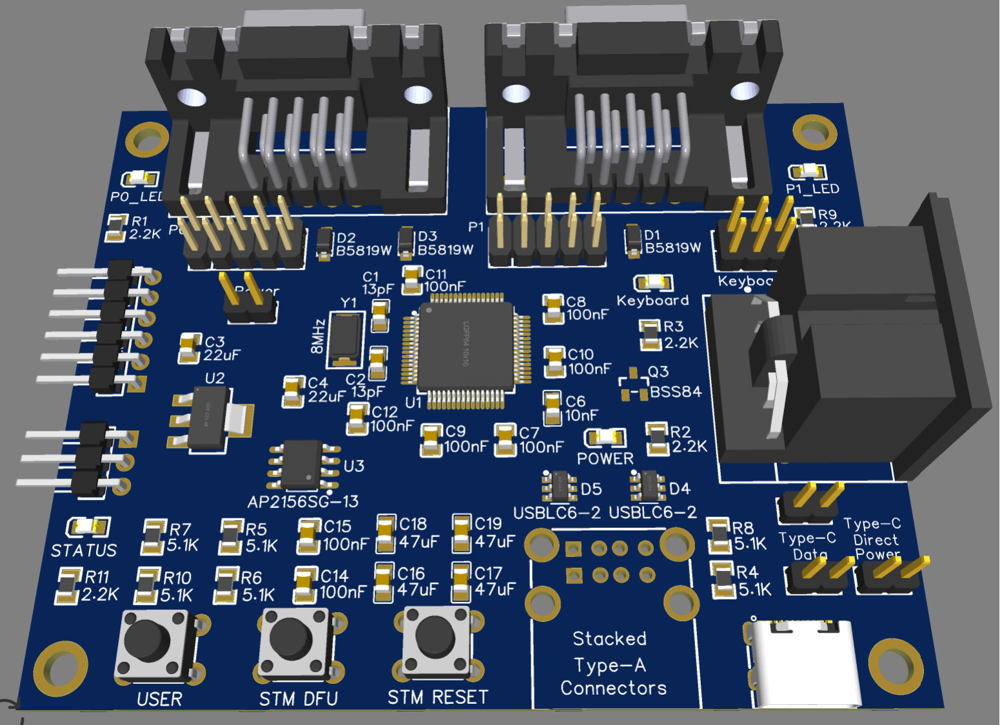

# KeyJAM Hardware Architecture

This document describes the KeyJAM Rev 1 hardware. See the
[schematic](Schematic_Amiga-KeyJam-USB-HID-to-Amiga_2026-04-05.pdf) for
full details.

[](2206_03_26_photo_view_placement.png)

## Block overview

```
 USB-A port 1 ──┐                                      ┌── Keyboard header / DIN-5 ── Amiga keyboard port
 (USB-C, via    ├── USB1 (OTG FS) ─┐                   │      KBCLK, KBDAT, KBRST
  jumpers)  ────┘                  │                   │
                                   ├── STM32F205RET6 ──┼── P0 header ── Amiga mouse port
 USB-A port 2 ───── USB2 ──────────┘     120 MHz       │      Up, Down, Left, Right, Fire, POTX, POTY
                                                       │
                                                       └── P1 header ── Amiga joystick port
                                                              Up, Down, Left, Right, Fire, POTX, POTY
```

## Microcontroller

- **STM32F205RET6**: ARM Cortex-M3, 120 MHz, 512 KB flash, 128 KB SRAM, LQFP64.
- 8 MHz crystal (Y1) for the high speed clock.
- Two USB controllers, each driving one USB host port.

## Power

- 5V (V5) is supplied through B5819W Schottky diodes from the Amiga keyboard
  port (D1), mouse port P0 (D2), and joystick port P1 (D3), or directly from
  USB-C through the **Type-C Direct Power** jumper.
- An AMS1117-3.3 regulator (U2) provides 3.3V for the microcontroller.
- A 2-pin **Power** header (GND, V5) provides access to the 5V rail.

## USB

- **Stacked USB Type-A connector** (USB1) provides two host ports.
- **AP2156** dual power switch (U3) provides switched, current-limited 5V to
  each USB-A port. Each port is enabled by the firmware (USB_ENABLE1 and
  USB_ENABLE2, pulled down by default) and has 47uF + 47uF + 100nF of bulk
  and bypass capacitance.
- **USB-C connector** (USB3):
  - 5.1K pull-downs on CC1 and CC2, so USB-C power supplies provide 5V.
    CC1 and CC2 are also connected to the microcontroller.
  - The **Type-C Data** jumpers (USBDP, USBDM) connect the USB-C data lines
    to USB port 1, which is also the STM32 USB DFU bootloader port.
  - The **Type-C Direct Power** jumper (USBDirect) connects USB-C VBUS to V5.
- The schematic includes USBLC6-2 ESD protection on both USB data pairs.

## Amiga keyboard

- KBCLK and KBDAT connect to the Amiga keyboard port, plus a KBRST signal
  on the keyboard header.
- Rev 1 provides both a 2x3 keyboard header (used by the supplied keyboard
  cables) and a 5-pin DIN socket, wired in parallel.
- A BSS84 P-channel MOSFET (Q3) drives the **Keyboard** LED from KBCLK
  activity.

## Amiga mouse / joystick ports

- Two ports, **P0** (mouse port) and **P1** (joystick port), each on a 2x5
  header for the supplied DB9 cables. The PCB also has footprints for
  board-mounted right-angle DB9 connectors.
- Each port carries Up, Down, Left, Right, Fire, POTX, POTY, +5V, and GND.
  All signals except power are connected to the microcontroller.

## Buttons

| Button | Function |
| ------ | -------- |
| USER | General purpose input to the firmware. |
| STM DFU | Drives BOOT0 high to enter the STM32 ROM bootloader on reset. |
| STM RESET | Resets the microcontroller. |

## LEDs

| LED | Driven by |
| --- | --------- |
| POWER | Microcontroller (POWER_LED) |
| STATUS | Microcontroller (STATUS_LED) |
| Keyboard | KBCLK activity, through Q3 |
| P0_LED | Microcontroller |
| P1_LED | Microcontroller |

## Headers

| Header | Signals | Purpose |
| ------ | ------- | ------- |
| STM32 SWD | V3P3, CLK, GND, DAT, NRST, TDO | Programming and debug |
| Console | GND, Tx, Rx | 3.3V serial console |
| SPI | CLK, MISO, MOSI, CS1, CS2, GND | Expansion (unpopulated on Rev 1) |
| Power | GND, V5 | 5V rail access |
| Keyboard | KBCLK, KBDAT, NC, GND, KBD_V5, KBRST | Amiga keyboard cable |
| P0, P1 | DB9 port signals | Amiga mouse / joystick cables |
