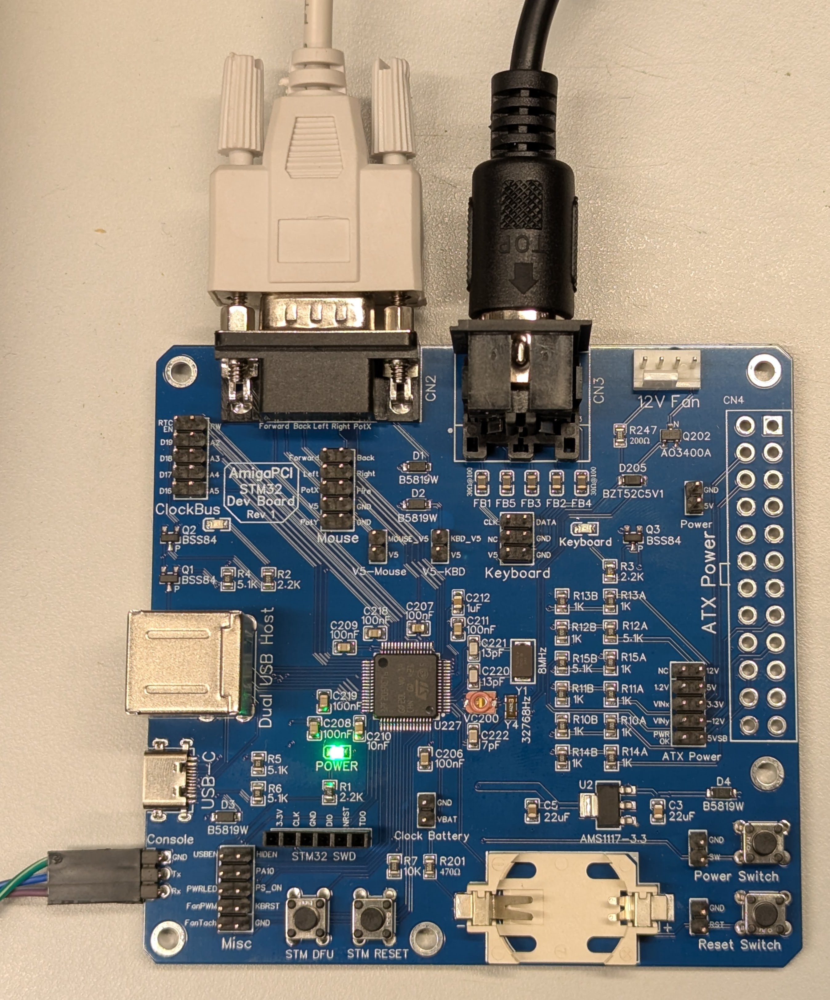
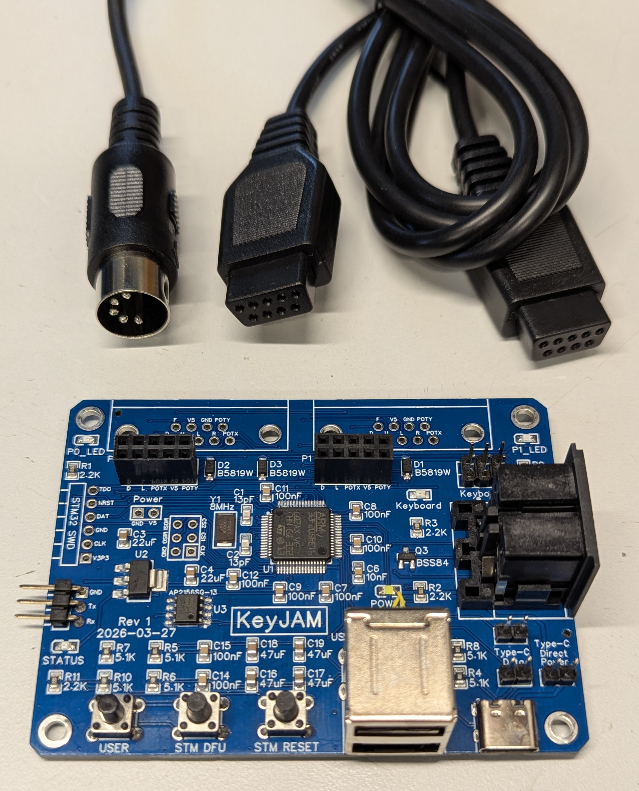

# KeyJAM Hardware Revisions

## Prototype: AmigaPCI STM32 Dev Board

KeyJAM's USB-to-Amiga keyboard and mouse function was developed on the
AmigaPCI STM32 Dev Board, which uses the same STM32F205 microcontroller
family and a dual USB host connector, with an Amiga mouse port and
keyboard connector.

## Rev 1 (2026-03-27)

- STM32F205RET6 microcontroller.
- Two stacked USB Type-A host ports with switched, current-limited power.
- USB-C port for power, firmware updates, and optional use as USB port 1
  (jumper selected).
- Two Amiga mouse / joystick ports on 2x5 headers, for DB9 cables.
- Amiga keyboard on a 2x3 header and an on-board 5-pin DIN socket.
- USER, STM DFU, and STM RESET buttons.
- SWD, serial console, SPI, and power headers.

Schematic: [Schematic_Amiga-KeyJam-USB-HID-to-Amiga_2026-04-05.pdf](Schematic_Amiga-KeyJam-USB-HID-to-Amiga_2026-04-05.pdf)

## Planned changes

- Remove the on-board 5-pin DIN keyboard socket. It is not needed, as a
  keyboard cable is supplied with each unit.
